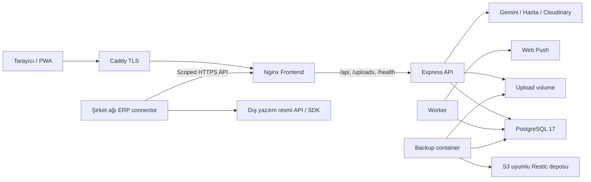

# Mimari

## Mimari Stil

Sistem web arayüzü, API ve ayrı worker sürecinden oluşur:

- React SPA, statik olarak Nginx tarafından sunulur.
- Express API aynı process içinde domain route ve servislerini çalıştırır.
- Ayrı worker process'i zamanlanmış işleri yürütür.
- API ve worker aynı veritabanını ve upload volume'unu kullanır.

## İstek Akışı

1. Caddy TLS sonlandırır ve isteği frontend container'ına iletir.
2. Nginx statik dosyaları sunar; API, upload ve health yollarını backend'e
   proxy eder.
3. Express request ID, güvenlik başlıkları, CORS, cookie, JSON, hata sözleşmesi,
   metrik ve rate limit middleware'lerini uygular.
4. Authenticated istekte veritabanındaki oturum ve mutasyonlarda CSRF token
   doğrulanır.
5. Route/controller, service ve repository üzerinden veritabanına erişir.
6. Yerel korumalı dosyalar Nginx `X-Accel-Redirect` akışıyla sunulabilir.

## Kaynak Sınırları

| Sınır | Kaynak |
| --- | --- |
| Uygulama başlangıcı | `backend/index.js`, `backend/worker.js` |
| Veritabanı adaptörü | `backend/database.js`, `backend/db/` |
| Şema yaşam döngüsü | `backend/migrations/`, `backend/db/schema/` |
| Domain API'leri | `backend/modules/`, `backend/routes/` |
| Ortak HTTP altyapısı | `backend/core/`, `backend/middleware/` |
| React giriş ve router | `frontend/src/main.tsx`, `frontend/src/router.tsx` |
| İstemci veri erişimi | `frontend/src/services/api.ts`, `secureFetch.ts` |
| Reverse proxy | `Caddyfile`, `frontend/nginx.conf` |
| Deployment | `docker-compose.prod.yml`, `.github/workflows/` |

## Durum ve Ölçekleme

- API oturumları, login guard'ları ve scheduler lease'leri veritabanında
  tutulduğu için process yeniden başlatmalarından etkilenmez.
- Worker lease kullanımı aynı işin birden fazla process tarafından
  çalıştırılmasını sınırlar.
- `app_settings` için 30 saniyelik process içi cache vardır; dağıtık cache
  bulunmaz.
- Upload'lar ortak Docker volume'undadır. Birden fazla VPS/backend node'u
  kullanmak için paylaşımlı object storage veya dosya sistemi gerekir.
- Depo tek kurum için API, worker ve web arayüzü içerir. Kapasite sınırı
  kod yapısından çıkarılamaz; yük testi ve üretim ölçümleriyle belirlenir.

## Mimari Kararlar

- Production ve yerel container hedef veritabanı PostgreSQL'dir. SQLite yalnız
  izole otomatik test adaptörü olarak korunur.
- Authentication JWT değil, veritabanı destekli opaque session'dır.
- Production image'ları commit SHA ile değişmez olarak yayınlanır.
- Şema değişikliği uygulama açılışından önce migration container'ında çalışır.
- Veritabanı bağlantısı, API ve worker şema bootstrap veya seed çalıştırmaz.
- Yerel kurulum, test ve production aynı sürümlü migration zincirini kullanır;
  yalnız development örnek verisi ayrı ve açık bir komuttur.
- CSP Express'te kapalıdır; production Nginx'te tanımlıdır.
- Logo ERP entegrasyonu portalın içine ürün özel SDK gömmez. Şirket ağındaki
  connector outbound HTTPS ile sürümlü portal makine API'sini kullanır; böylece
  ERP'nin internete açılması gerekmez.

Mevcut teknik sınırlar ve geliştirme konuları
[Geliştirme konuları](improvements.md) dosyasında tutulur.
