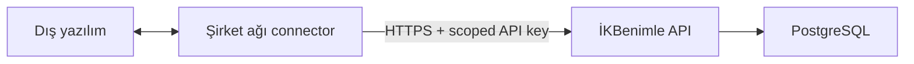

# Genel API Entegrasyonu

## Sınır ve Mimari

ERP, bordro, İK ve özel yazılımlar aynı `/api/integrations/v1` sözleşmesini kullanır.
Yeni bağlantılarda `generic_bridge` varsayılandır. Mevcut `logo_bridge`
bağlantıları ve API adresleri çalışmaya devam eder.

Dış yazılım veya şirket ağındaki bağlantı servisi kaynak alanları portal
alanlarına dönüştürür ve HTTPS istekleri gönderir. Hazır ürün bağlantıları
bulunmaz; ürünün resmi API/SDK desteğine göre uyarlama gerekir.



## Yönetim Kurulumu

`Entegrasyonlar` ekranı `manage_integrations` izni gerektirir. Ekran teknik
terimler yerine `Veri Akışları`, `Aktarım Geçmişi` ve `Teknik Kurulum` olmak
üzere üç bölüme ayrılır. Çalışan, izin bakiyesi, izin talebi ve bordro akışları
ana ekranda yönleriyle birlikte gösterilir; endpoint ve kapsam adları yalnız
geliştirici ayrıntılarında yer alır.

1. Bağlantı oluşturulur ve gerekli veri akışları seçilir.
2. Seçilen akışlara göre önerilen güvenli erişim yetkileriyle bir API anahtarı üretilir.
3. API anahtarının açık değeri yalnız bir kez gösterilir ve connector'ın güvenli deposuna alınır.
4. Mümkünse connector çıkış IP'si allowlist'e eklenir ve son kullanma tarihi
   belirlenir.
5. Connector önce `GET /api/integrations/v1/status` ile bağlantıyı sınar.
6. Yönetim ekranındaki kuyruk ve audit kayıtları izlenir.

Panel Logo kullanıcı adı, parola, veritabanı parolası veya ERP base URL'si
saklamaz. Bu değerler connector tarafının secret yönetiminde kalır.

## Kimlik ve Header'lar

Her makine isteği:

```http
Authorization: Bearer <integration-api-key>
Content-Type: application/json
```

Çalışan ve bakiye senkronizasyon istekleri ayrıca 16-128 karakterlik, her mantıksal işlem
için sabit ve benzersiz bir header taşır:

```http
Idempotency-Key: <connector-generated-operation-id>
```

Aynı anahtarla tekrarlanan başarılı istek önceki sonucu döndürür ve
`X-Idempotent-Replay: true` header'ı ekler.

## Kapsamlar ve Endpoint'ler

| Endpoint | Kapsam | İşlev |
| --- | --- | --- |
| `GET /api/integrations/v1/status` | Geçerli anahtar | Bağlantı sınama |
| `POST /api/integrations/v1/employees/upsert` | `employees:write` | En fazla 100 çalışanı ekleme/güncelleme |
| `POST /api/integrations/v1/leave-balances/upsert` | `leave-balances:write` | En fazla 500 izin bakiyesi güncelleme |
| `GET /api/integrations/v1/leave-requests?limit=25` | `leave-requests:read` | Aktarım kuyruğunu 120 saniye kiralama |
| `POST /api/integrations/v1/leave-requests/:id/ack` | `leave-requests:ack` | Dış yazılıma aktarım sonucunu bildirme |

Şemalar strict'tir; tanımsız alanlar reddedilir. Tarih `YYYY-MM-DD`, timestamp
ise offset içeren ISO-8601 biçimindedir.

## Çalışan Senkronu

```json
{
  "employees": [
    {
      "external_employee_id": "<erp-record-id>",
      "employee_id": "<employee-number>",
      "name": "<full-name>",
      "department": "<department>",
      "position": "<position-or-null>",
      "manager_employee_id": "<manager-employee-number-or-null>",
      "status": "active",
      "source_updated_at": "2026-08-20T08:00:00+03:00"
    }
  ]
}
```

`email`, `phone` ve `birth_date` opsiyoneldir. Rol, izin ve parola alanları
kabul edilmez. Yeni kayıtlar employee rolünde ve parolasız oluşturulur; portal
yöneticisi güvenli aktivasyon tamamlamadan kullanıcı giriş yapamaz.

## İzin Bakiyesi

Çalışan önce `external_employee_id` ile eşleşmiş olmalıdır.

```json
{
  "balances": [
    {
      "external_employee_id": "<erp-record-id>",
      "balance_days": 12.5,
      "as_of_date": "2026-08-20",
      "source_updated_at": "2026-08-20T08:05:00+03:00"
    }
  ]
}
```

Bu değer kullanıcı anasayfasında salt okunur gösterilir. Portal izin bakiyesini
hesaplamaz veya dış yazılıma bakiye yazmaz.

## İzin Talebi Aktarımı

İzin talebi yerel kayıtla aynı transaction içinde outbox'a yazılır. Connector
kuyruğu çeker, payload'ı hedef yazılımın resmi sözleşmesine dönüştürür ve sonucu ACK
eder.

Başarılı aktarım sonucu:

```json
{
  "status": "succeeded",
  "external_reference": "<external-reference>"
}
```

Başarısız aktarım sonucu:

```json
{
  "status": "failed",
  "error_code": "<stable-error-code>",
  "error_message": "<safe-summary>",
  "retry_after_seconds": 300
}
```

Başarısız kayıtlar üstel gecikmeyle en fazla sekiz kez denenir; sonra
`dead_letter` olur. Kiralama, aynı anda başka connector'a teslimatı sınırlar.
Connector sonucu ACK etmeden kesilirse veya kira süresi dolarsa aynı iş yeniden
teslim edilebilir. Connector, ERP tarafındaki yazmayı da tekrara dayanıklı
kurmalıdır; portal ERP'de tam bir kez işleme garantisi vermez.

## Operasyon ve Güvenlik

- API anahtarı connector secret store'unda tutulur; kaynak koda veya loga
  yazılmaz.
- Anahtarlar veri akışı başına ayrılmalı ve düzenli döndürülmelidir.
- Eski anahtar yenisi doğrulandıktan sonra iptal edilir.
- Connector timeout, retry ve exponential backoff kullanmalıdır.
- Portal audit ekranı başarısız senkron ve dead-letter kayıtları için düzenli
  izlenmelidir.
- Payload'a ERP access token, parola, sağlık verisi veya gereksiz kişisel veri
  eklenmemelidir.
- `source_updated_at` aynı kaydın eski ERP sürümüyle ezilmesini engeller.

Aktarım sonucu, talebin karşı uygulamada kaydedilip kaydedilemediğini belirtir.
Karşı uygulamadaki onay veya ret kararını portalın izin durumuna yazmaz.

## Kurulum rehberi ve durumlar

Teknik Kurulum bölümü önce erişim anahtarı, API adresi ve bağlantı testini sade
adımlarla gösterir. Örnek JSON, alan eşleştirmeleri, hata açıklamaları, kapsam
adları ve endpoint listesi `Geliştirici ayrıntıları` altında kapalı başlar.
İndirilebilir Postman koleksiyonunda base_url, api_key ve job_id değişkenleri
ayarlanır. Aynı işlemi tekrar denerken ilk Idempotency-Key değeri korunmalıdır.

Durumu Yenile portal kayıtlarını yeniler. Gerçek bağlantı testi dış yazılımdan
status endpoint'ine yapılır. Son API isteği ve son veri aktarımı ayrı gösterilir.
Başarısız izin aktarımı hata olarak gösterilir; sonraki başarılı aktarım bu
durumu kaldırır. Yeni bağlantılarda izin aktarımı portal onayından sonra başlar.
Mevcut bağlantıların aktarım tercihi korunur.

Ürüne özel bağlantılar resmi API/SDK ve alan eşlemelerine göre ayrıca geliştirilir.

## ERP bordro PDF aktarımı

`POST /api/integrations/v1/payrolls/upsert` için `payrolls:write` kapsamı gerekir.
Mevcut anahtarların yetkileri kendiliğinden genişlemez; bordro yetkili yeni anahtar oluşturun.
`multipart/form-data` alanları: external_employee_id (en fazla 100 karakter),
external_payroll_id (en fazla 100 karakter), period (YYYY-MM), revision (pozitif
integer; varsayılan 1), file (tek PDF, en fazla 20 MB). MIME, .pdf uzantısı ve PDF
imzası denetlenir. Content-Type boundary değerini HTTP istemcisi oluşturmalıdır.
Çalışan önce aynı bağlantı üzerinden employees/upsert ile eşleştirilmelidir.

Bordro kimliği bağlantı içinde benzersizdir. Aynı kimlik/revizyon ve aynı dosya
tekrarında mevcut document_id döner; X-Idempotent-Replay: true eklenir. Bu endpoint
ayrı Idempotency-Key istemez. Düzeltmede aynı kimlik, çalışan ve dönem korunur;
revision artırılır. Aynı dönem için farklı bordro kimliği, başka çalışan/döneme
taşınan kimlik, eski revizyon veya aynı revizyonda değişen PDF 409 döndürür.
Tek bağlantı/çalışan/dönem için bir bordro desteklenir; ayrı ek bordro türleri yoktur.

Yanıt: { document_id, revision, replayed }. PDF mevcut Bordrolarım listesinde
YYYY-MM Bordrosu başlığıyla görünür. Dosyalar Cloudinary yapılandırılsa bile korumalı
yerel documents alanında tutulur; mevcut upload volume yedekleme ve erişim kuralları
geçerlidir. Dosya sahibi ve manage_documents yetkilileri erişebilir. Güncellemede
belge kimliği korunur; önceki PDF başarılı commit sonrası kaldırılır. Veritabanı
hatasında yeni dosya silinir ve önceki bordro korunur. Silme arızası loglanır;
ani process kesintilerinde sahipsiz dosyalar için operasyonel temizlik gerekebilir.
PDF imzası kontrolü antivirüs taraması veya PDF içeriğinin doğrulanması değildir.

Örnek (PowerShell, curl.exe):

```powershell
curl.exe -X POST "$env:PORTAL_URL/api/integrations/v1/payrolls/upsert" -H "Authorization: Bearer $env:PORTAL_API_KEY" -F "external_employee_id=person-1001" -F "external_payroll_id=payroll-1001-2026-11" -F "period=2026-11" -F "revision=1" -F "file=@ornek-bordro.pdf;type=application/pdf"
```

Yetkisiz anahtar 401, kapsamı eksik anahtar 403, eşleşmeyen çalışan/çakışan kayıt
409, geçersiz form veya dosya 400, 20 MB üzeri dosya 413 döndürür.
